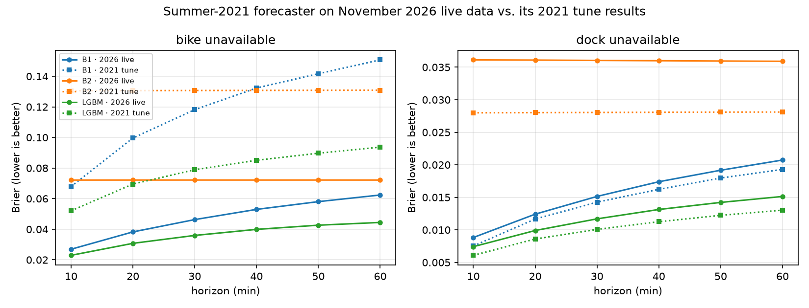

# Does the 2021 forecaster still work in 2026? (live-data validation)

Peers asked how a model trained on summer 2021 can predict 2026 conditions. This replays **24 days of our own full-GBFS collector data (2026-10-31 00:15 CDT to 2026-11-23 17:08 CST)** for the 32 app stations and scores the bundled forecaster (`forecaster_v0_m3`, unchanged) against B1 persistence and B2 (2021 weekday × hour rates). Nothing is trained or tuned on this data.

- **Features** come from the app's own Live builder (`backend.providers.Providers.live_features`) on a 10-minute grid, so this measures what Live mode serves. Base observations older than 15 minutes are dropped, as in training.
- **Labels** follow the training rule: the nearest observation after the decision within ±5 minutes of decision + horizon (median offset 34 s). Bike (dock) unavailable = 0 bikes (docks) or not installed + renting (returning).
- **Time** is absolute in the collector (epoch). Hour, weekday, B2 keys and service days use America/Chicago via IANA zoneinfo. As in the historical pipeline, rows whose decision or target local time falls in the repeated 01:00–02:00 of the DST change on **2026-11-01** are excluded (2,883 rows, 0.6%).
- **Data:** 17,071 polls, median interval 120 s, one gap over 15 minutes. **All 32 stations are still in the feed after five years.** 631,308 rows (3,390 decision times × stations × 6 horizons) over 24 service days. (Earlier runs: 19 days on Nov 18, 22 days on Nov 21; same conclusions.)



## All horizons

| | Base rate | Brier B1 / B2 / **LGBM** | PR-AUC B1 / B2 / **LGBM** | ECE **LGBM** |
|---|---|---|---|---|
| Bike, 2026 live | 7.4% | 0.048 / 0.072 / **0.036** | 0.48 / 0.12 / **0.71** | 1.3 pp |
| Bike, 2021 tune | 16.3% | 0.118 / 0.131 / **0.078** | 0.47 / 0.33 / **0.71** | 1.4 pp |
| Dock, 2026 live | 3.1% | 0.016 / 0.036 / **0.012** | 0.57 / 0.06 / **0.80** | 0.4 pp |
| Dock, 2021 tune | 2.3% | 0.015 / 0.028 / **0.010** | 0.47 / 0.05 / **0.74** | 0.1 pp |

LGBM vs the better baseline (B1 in 2026), paired 24-day block bootstrap:

| | All horizons | 10 min | 30 min | 60 min |
|---|---|---|---|---|
| Bike Brier change | **−24%** (−26 to −21) | −15% (−17 to −12) | −22% (−25 to −20) | −29% (−31 to −26) |
| Dock Brier change | **−24%** (−27 to −20) | −16% (−19 to −12) | −23% (−26 to −18) | −27% (−30 to −23) |

## Findings

- **The forecaster transfers.** Five years and a season later it still cuts Brier by about 24% against the best baseline for both bikes and docks, with every interval excluding zero. Its ranking quality is unchanged for bikes (PR-AUC 0.71 vs 0.71) and higher for docks (0.80 vs 0.74). In 2021 the gain over the better baseline was 34% / 30%; the smaller 2026 margin comes with a much easier B1 (half the bike base rate in November).
- **Memorized calendar patterns do not transfer; current-state signals do.** B2's 2021 weekday × hour rates collapse in 2026 (bike PR-AUC 0.33 → 0.12) while the forecaster, which mainly reads current counts and recent changes, holds up. This is the answer to "new buildings and construction since 2021": the model reacts to what the station is doing now.
- **Calibration is still good overall** (ECE 1.3 pp bike, 0.4 pp dock) but **under-predicts in the middle range** at 30 minutes: forecasts of 45–55% become 59–65% observed for bikes and 60–66% for docks. Recalibrating on recent data (no retraining) fixes most of it: see [recalibration](recalibration/README.md) (held-out ECE 1.37 → 0.43 pp for bikes, 0.43 → 0.19 pp for docks), now used by Live mode.
- **Docks stay predictable in winter** (base rate 3.3%), supporting the dock-side features of the app.

## Limits

- Year and season shift together (summer 2021 → November 2026); this cannot separate them.
- Only the 32 stations that already existed in 2021. Stations opened since then are outside the model's station categories and would be served by fallbacks.
- 24 days; one demand regime (late autumn). Live labels use GBFS installed/renting/returning flags; 2021 labels used the historical "In Service" status.
- Observation times use the station's `last_reported` (median 104 s before the poll), as Live mode does.

Reproduce (about 5 minutes the first time; parsed polls are cached under `.local/live_validation/`):

```bash
.venv/bin/python scripts/model/validate_live_2026.py --live-root <collector>/divvy/current_validation
```
