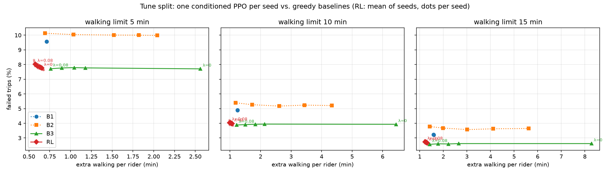

# One preference-conditioned PPO for every rider (tune split)

The M3 PPO was trained for one setting (λ = 0.02, 10-minute walking limit), so the app's default 5-minute limit silently fell back to B3. `train_ppo.py --conditioned` trains **one policy per seed** that samples λ ∈ {0, .005, .01, .02, .04, .08, .16} and the walking limit ∈ {5, 10, 15} per episode and reads both from its observation (31 + 2 features). Training: weeks 2–9 replay, forward-chained forecaster scores, 1.5M steps, seeds 0/1/2 (~6 min each on CPU).

`conditioned_eval.py` evaluates the same three models in every (walk limit, λ) cell next to B1/B2/B3 greedy with that λ, on the identical 20,071 tune grid requests. Intervals are paired Chicago-day bootstrap (14 days). Test is not opened.

## Results at the app's λ = 0.02 (RL: mean of 3 seeds)

| Walk limit | Failed trips B1 / B3 / RL | Extra walking B3 / RL (min) | Mean reward B3 / RL | RL − B3 reward (95% CI, all seeds) |
|---|---|---|---|---|
| 5 min | 9.56% / 7.79% / 7.84% | 1.05 / 0.63 | 0.845 / 0.852 | +0.006 (0.002 to 0.010) |
| 10 min | 4.90% / 3.93% / 4.00% | 1.83 / 1.04 | 0.895 / 0.909 | +0.014 (0.011 to 0.019) |
| 15 min | 3.24% / 2.59% / 2.69% | 2.22 / 1.28 | 0.909 / 0.927 | +0.018 (0.015 to 0.021) |

## Findings

- **One model replaces the per-setting models.** At 10 min / λ = .02 it matches the dedicated M3 sweep models (reward 0.909 vs 0.909, failure 4.00% vs 4.07%), and it also serves 5 and 15 minutes.
- **Higher reward than B3 in every cell with λ > 0** (12/15 cells; all three seeds' intervals exclude zero in 11 of them). At λ = 0 the two tie.
- **RL walks less than B3 in all 15 cells** (0.2 to 7 minutes less per rider), with failure rates statistically tied: RL − B3 success is −0.03 to −0.31 points, and 33 of the 45 seed × cell intervals include zero.
- **The forecaster carries the failure reduction.** B3 and RL both fail 17–20% less often than B1 at every walk limit (5 min: 7.8% vs 9.6%). RL's gain is the walking/reliability trade-off, not fewer failures.
- Return-side failures are rare in this cohort (0.1–0.6%), so the dock forecast's value shows in targeted scenarios (see docs/app_demo.md, "Dock fills up") rather than in network averages.

Reproduce: `make rl-train-conditioned` then `make rl-eval-conditioned` (set `DATA_ROOT`).
