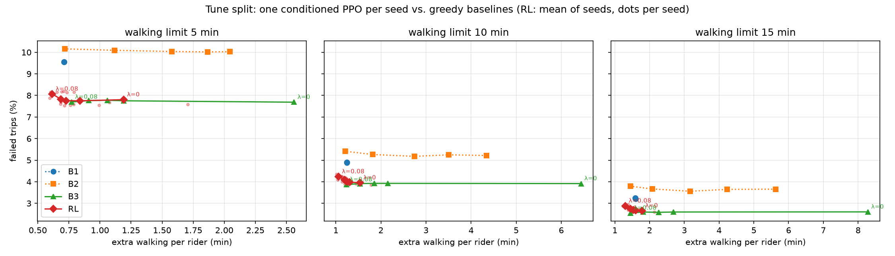

# Conditioned PPO with a failed-attempt penalty (f = 0.1, tune split)

[The first conditioned PPO](../conditioned/README.md) walked less than B3 partly by making more failed attempts: the M3 reward charged walking but not a failed attempt itself. This run adds **f = 0.1 per failed pickup/return attempt** (about five walking minutes at λ = .02) to the reward of every policy: the environment charges it, and B3 greedy scores a slot as `1 − (1 + c + f)·p − λ·walk`. Training and evaluation are otherwise identical (1.5M steps, seeds 0/1/2, same 20,071 tune grid requests, Chicago-day bootstrap). "RL (f=0)" is the earlier conditioned model on the same episodes, its reward rescored as `reward − 0.1 × failed attempts`.

## At the app's λ = 0.02 (RL: mean of 3 seeds)

| Walk limit | Failed trips B3 / RL f=0 / RL f=0.1 | Failed attempts per rider B3 / RL f=0 / RL f=0.1 | Extra walking B3 / RL f=0 / RL f=0.1 | Reward with f (B3 / RL f=0 / RL f=0.1) |
|---|---|---|---|---|
| 5 min | 7.78% / 7.84% / 7.75% | 0.142 / 0.181 / 0.154 | 1.06 / 0.63 / 0.73 | 0.831 / 0.834 / 0.836 |
| 10 min | 3.92% / 4.00% / 4.00% | 0.110 / 0.195 / 0.138 | 1.86 / 1.04 / 1.24 | 0.883 / 0.890 / 0.892 |
| 15 min | 2.58% / 2.69% / 2.69% | 0.107 / 0.202 / 0.141 | 2.26 / 1.28 / 1.52 | 0.897 / 0.906 / 0.909 |

## Findings

- **The penalty removes most of RL's extra failed attempts.** RL's excess over B3 falls by 65–70% (10 min: 0.085 → 0.028 per rider). It still walks 0.3–0.7 min less than B3 at λ = .02.
- **Trip success is about unchanged on average** (RL − B3, mean of seeds: −0.1 to +0.02 points), **but it depends on the seed**: at 5 min seed 0 is 0.4 points worse while seeds 1–2 are 0.2 points better (intervals exclude zero); at 10 min seed 0 is 0.3 points worse and seeds 1–2 tie; at 15 min no seed differs significantly. Seed 1 has the highest mean tune reward and never a significantly lower success rate than B3 at λ = .02.
- **RL now beats B3 on the full reward at every walk limit for λ = .01–.04**: +0.009 at 10 min and +0.012 at 15 min with all three seeds' intervals above zero; +0.005 at 5 min (two of three seeds).
- **Limit at high λ.** At λ = .08, RL fails more often than B3 at 10/15 min (4.24% vs 3.87%, 2.88% vs 2.55%; all seeds significant). The app uses λ = .02.
- Example (2021-07-21 17:36, Larrabee & Menomonee, 25% bike chance, observed empty): at 10 and 15 min the f = 0.1 policy sends the rider to Larrabee & North Ave (observed 6 bikes); the f = 0 policy tried the empty origin first.

Reproduce: `make rl-train-conditioned rl-eval-conditioned RL_F=0.1` (set `DATA_ROOT`).
